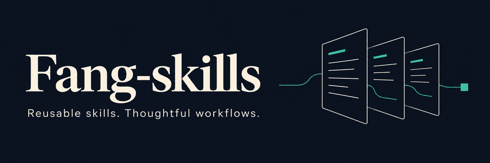

[開啟 Skill Prompt 產生器 ↗](https://sces5504.github.io/Fang-skills/)

<p align="center">
  
</p>

<p align="center">
  <a href="https://sces5504.github.io/Fang-skills/"></a>
  <a href="https://github.com/sces5504/Fang-skills/tree/main/skills"></a>
  <a href="https://github.com/sces5504/Fang-skills"></a>
</p>

# 可跨專案使用的 Codex 技能

Fang-skills 收錄我持續整理的 Agent Skills，將可重複的工作方法寫成 Codex 能讀取的指引。技能集中維護，需要時由目標專案的 Codex 取得並執行，無須把整個技能庫放進每個專案。

## 選一個技能，帶到你的專案

開啟 **[Prompt 產生器](https://sces5504.github.io/Fang-skills/)**，選擇技能、填入任務，再將產生的文字貼到目標專案的 Codex 對話。也可以指定 branch、tag 或 commit，決定要使用的技能版本。

技能清單直接讀取中央 repo：開啟頁面、回到分頁，以及頁面開著時每五分鐘同步。新增符合格式的技能資料夾後，頁面會在下一次同步顯示，不需另外維護清單。任務文字只在瀏覽器內組合，不會傳送到 GitHub；目標 Codex 環境仍需能存取 GitHub 才能取得技能。

### 直接複製這段 prompt

以下以 `polisher` 為例；換用其他技能時，修改前兩行的技能名稱與任務即可。

```text
技能：polisher
任務：改善目前專案的 README 文案、排版、橫幅與徽章，以及 GitHub Pages 社群分享預覽。請呈現專業成熟的風格，先理解專案的實際內容。

請從 https://github.com/sces5504/Fang-skills 的 main 分支，取得 skills/ 下上述技能的完整資料夾，包含 SKILL.md 與必要資源，存到目前專案之外的暫存目錄，並記錄實際來源 commit。

完整閱讀 SKILL.md，依需要讀取參考文件、檢查腳本用途，再依技能流程執行上述任務。不要把技能安裝進目前專案，不要修改 AGENTS.md 或其他全專案指令，不要指派或干涉其他 AI。保留使用者尚未提交的修改，遵守技能的修改範圍。

若無法取得完整技能，請說明原因並停止，不要假裝已載入。完成後以繁體中文簡潔回報修改與實際驗證結果。未經我另外要求，不要自動提交、推送或部署。
```

這是臨時讀取並執行技能，不會讓目標專案自動永久載入它。若要固定結果，可將 `main` 換成指定的 commit；若要長期自動發現技能，再另行安裝到 `.agents/skills/`。

## 技能目錄

### [polisher](skills/polisher/SKILL.md)

整理既有專案的兩個對外門面：GitHub README 與 GitHub Pages 分享預覽。涵蓋文案、版面、橫幅、徽章，以及社群標題、描述、封面和 metadata。README 橫幅與分享封面可各自設計，修改限於必要文件和展示素材。

完整清單以 **[skills/](skills/)** 與產生器的即時目錄為準。

## 新增與維護

每個技能放在 `skills/<skill-name>/`，其中 `SKILL.md` 至少包含 `name`、`description` 和操作指引；需要時再加入 `scripts/`、`references/` 或 `assets/`。資料夾名稱使用小寫英文字母、數字與連字號，並與技能名稱一致。技能應自成一體，避免依賴個人電腦的絕對路徑。

收錄第三方技能前，確認其授權允許預定的使用、修改與散布，保留原始授權及署名，並在 [來源紀錄](third-party/SOURCES.md) 記下上游網址、版本與修改內容。沒有明確授權的內容，先取得同意或僅保留來源連結。

## 授權

目前尚未為自製內容選定開源授權；公開可讀取不等於授予任意再散布權利。第三方內容依其各自授權。
